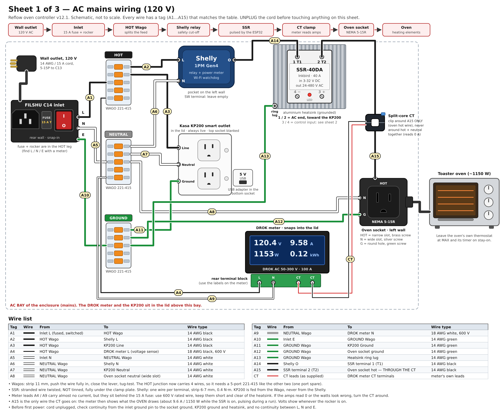
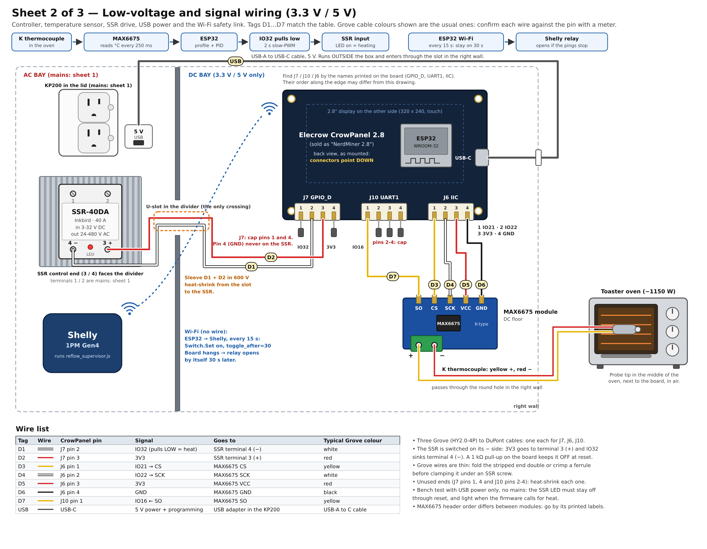

# 🌡️ DIY ESP32 Reflow Oven Controller (CrowPanel 2.8)

> **⚠️ SAFETY WARNING:** This project involves mains AC voltage, appliance modification, and high heat. Incorrect wiring can cause electric shock, fire, equipment damage, or severe injury. Do not attempt this unless you are experienced and comfortable working with mains AC wiring. Always verify wiring with a meter, confirm current ratings, use proper strain relief, bond ground correctly, and never leave the oven unattended while operating.

## 📖 Overview

This is a custom-built, cost-conscious reflow toaster oven controller for soldering Surface Mount Technology (SMT) printed circuit boards. It is a lower-cost alternative to reference designs like the [Adafruit EZ Make Oven](https://learn.adafruit.com/ez-make-oven/overview). It started on the "Cheap Yellow Display" (CYD, ESP32-2432S028R). **From v12 it uses the [Elecrow CrowPanel 2.8" ESP32 HMI](https://www.elecrow.com/esp32-display-2-8-inch-hmi-display-spi-tft-lcd-touch-screen.html)**, a CYD-class board that exposes enough I/O on keyed connectors to wire everything with **cables only, with no board modifications**.

The controller is housed in a standalone, 3D-printed bench enclosure next to the toaster oven. The touchscreen sits in **landscape on the front panel** (the long side).

### How It Works

* **Control:** Switches the oven heating elements through a Solid State Relay (SSR) using slow-PWM control (2-second window).
* **Sensing:** Reads the chamber temperature from a K-type thermocouple through a MAX6675 module.
* **Safety:** A Shelly 1PM Gen4 smart relay sits in the oven's hot conductor as an independent master cutoff with real-time power metering.
* **UI/UX:** Live reflow profiles, temperature graph and touch targets on the 320 × 240 landscape screen.

---

## ✨ Features & Project Status

* **CYD era (validated on the CYD, carried forward):** resistive touch UI, MAX6675 reading with a live graph, SSR switching at 3.3 V drive.
* **CrowPanel 2.8 (v12):** pinout and electrical details taken from Elecrow's own Eagle schematic and board files and its STEP model (see Pin Configuration). **Board not yet in hand:** run the bench checks below before wiring mains.
* **AC Distribution:** ✅ **Validated.** Inlet → Shelly → KP200 branch energized and confirmed. Shelly joins Wi-Fi and reports metering; the KP200 powers the display through a USB adapter.
* **Control:** Reflow firmware in `firmware/reflow_controller/` (profiles, PID with slow-PWM, safety aborts, Shelly heartbeat) and a Shelly supervisor script in `firmware/shelly/`. **Not yet run on hardware:** syntax-checked on a PC and simulated only. SSR load path (`T2` → oven) not yet connected.
* **Metering:** DROK AC multimeter (Amazon B0B3WVG2V9) snapped into the lid; its split-core CT is on the oven hot wire, so it shows what the oven draws.
* **Enclosure:** OpenSCAD parametric design (**v12.1, 250 × 155 × 83 mm, ASA**) that prints on a Bambu X1C without supports. Verified by surface scan, interference check (including Elecrow's real board model), and probe-ray test (see Enclosure section).
* **Safety Isolation:** An internal divider wall separates mains AC from the low-voltage side; one SSR-control pass-through only.
* **Fail-safes:** Fused rocker inlet, a Shelly 1PM Gen4 in the oven's hot path (survives a shorted SSR), SSR drive that is **off whenever the ESP32 is not actively driving it**, and a KP200 that can cut the controller's power.

---

## 🛠️ Bill of Materials (BOM)

| Component | Part / Model | Notes |
| :--- | :--- | :--- |
| **Microcontroller / UI** | [Elecrow CrowPanel 2.8" ESP32 HMI](https://www.elecrow.com/esp32-display-2-8-inch-hmi-display-spi-tft-lcd-touch-screen.html) (ESP32-WROOM-32-N4, ILI9341V, resistive touch) | Replaces the CYD in v12. Mounts on the front panel; its acrylic case is **not** used |
| **Cables to the display** | 3 × Grove / HY2.0-4P to female DuPont, ≥ 20 cm | One comes with the CrowPanel; buy two more. One end of the SSR cable is cut and stripped |
| **USB cable + adapter** | USB-A to USB-C (supplied with the CrowPanel) + 5 V USB adapter in the KP200 | The plug enters through the right-wall slot (15 × 9 mm); its overmold must be ≤ 13.5 × 7.5 mm |
| **Toaster Oven** | [Black & Decker TO1313SBD](https://a.co/d/00ZCCpC5) | 1150 W @ 120 V = **9.6 A continuous** |
| **Thermocouple Amp** | [MAX6675 Module + K-Type Thermocouple Probe](https://a.co/d/0htQOedm) | Runs from the CrowPanel's 3.3 V (MAX6675 supply range 3.0–5.5 V) |
| **Solid State Relay** | [Inkbird SSR-40DA + Aluminum Heatsink](https://a.co/d/078ydj3f) | Input 3–32 VDC per the listing. Wired with **bare wire under the clamp plates** (no lugs) |
| **Smart Master Relay** | [Shelly 1PM Gen4](https://a.co/d/01A2Ngha) (`S4SW-001P16EU`) | 16 A resistive, power metering, in the oven's hot path |
| **AC Power Inlet** | [FILSHU 15A 250V IEC320 C14 Panel Mount Rocker](https://a.co/d/0dQGxSvV) | **15A** single-pole rocker with 14 AWG leads; switches hot only; snap-in. Panel cutout spec 47.0–48.0 × 27.0–27.5 mm; side clips are made for a 1.5 mm panel (the wall is thinned beside them). Confirm ratings against the label molded on the module |
| **Inlet Fuse** | 15 A, 5 × 20 mm | Use a **ceramic, time-delay** fuse (glass bodies have low breaking capacity). Fitted type not yet recorded |
| **Power Cord (wall → inlet)** | NEMA 5-15P to IEC C13, **14 AWG SJT, rated 15 A** | **Required.** Typical PC cords are 18 AWG (10 A); 9.6 A would load one to 96 % |
| **Accessory Outlet** | [KP200 Smart Outlet Module](https://a.co/d/0it13pHO) | **Always-live**, feeds the display's 5 V through a USB adapter. Top socket blanked |
| **Oven Feed** | FILSHU 15A 125V NEMA 5-15R panel-mount socket, 14 AWG leads | Snaps into the left wall (model X = 0). 27 × 27 mm face, ~35 mm deep, cutout spec 24.5–25.0 mm square. 9.6 A is 64 % of its 15 A rating |
| **Splices** | [Wago](https://a.co/d/0g3QaYkX) 221-series lever nuts: 1 × 221-413, 2 × 221-415 | Hot, neutral and ground junctions (UL 486C: 600 V, 20 A, 24–12 AWG) |
| **Internal AC wire** | 14 AWG stranded UL 1015 (600 V, 105 °C), black / white / green, ~1 m each | Full shopping list with terminals, sleeving and fasteners: [docs/BUILD-GUIDE.md](docs/BUILD-GUIDE.md) |
| **Heat-set inserts** | 19 × M3 for 4.2 mm pockets + 2 for the KP200 (4.5 mm pockets) | 9 lid-screw (shell), 6 front-panel (shell posts, horizontal), 4 display standoffs (front panel) |
| **Screws** | 9 × M3 × 6 countersunk (lid), 6 × M3 × 8 countersunk (front panel), 4 × M3 × 5 pan head (display) | Each length stops short of the bottom of its insert pocket (lid 2 mm, panel 1 mm, display 0.6 mm) |
| **Enclosure Material** | **ASA** | Glass transition ~100 °C vs PETG ~81 °C; the heatsink stands on the printed floor. **Do not use PLA** |

---

## 📁 Repository Structure

```text
CYD-ReFlow-Oven/
├── 3MF/
│   ├── reflow-v12_0-coupons.3mf                    # Socket + inlet + CrowPanel coupons, one plate — print FIRST
│   ├── reflow-v12_1-drok-meter-coupon.3mf          # DROK meter cutout coupon — print FIRST
│   ├── reflow-v12_1-lid.3mf                        # v12.1 lid (same part as the STL)
│   ├── legacy-v11_0/                               # v11 coupons (socket and inlet coupons are unchanged in v12)
│   └── legacy-v10_3/
├── OpenSCAD/
│   ├── reflow-enclosure-flat-v12_1-front-panel-x1c.scad  # ✅ CURRENT master source of record
│   └── legacy-v11_0/                               # v11 source (230 mm box, CYD on the lid)
├── STL/
│   ├── reflow-v12_0-bottom.stl                     # Bottom shell: floor, rear/side walls, divider, posts (unchanged in v12.1)
│   ├── reflow-v12_1-lid.stl                        # Lid with the DROK meter cutout, pre-mirrored for printing
│   ├── reflow-v12_1-drok-meter-coupon.stl          # 3 meter cutout sizes × 2 panel thicknesses
│   ├── reflow-v12_0-front-panel.stl                # Front panel with display window, printed face down (unchanged in v12.1)
│   ├── reflow-v12_0-crowpanel-coupon.stl           # Display region of the front panel, 1:1
│   ├── reflow-v12_0-oven-socket-coupon.stl         # 3 cut sizes × 3 panel thicknesses
│   ├── reflow-v12_0-iec-coupon.stl                 # Inlet cutout + clip reliefs
│   ├── legacy-v11_0/                               # v11 230 mm box (CYD on the lid)
│   └── legacy-v10_3/
├── tools/
│   ├── verify_enclosure.py                         # Mesh health, supports, interference, probe rays, real-board fit
│   ├── step_parts.py                               # Splits Elecrow's STEP into per-solid STLs for the fit check
│   ├── make_wiring_diagrams.py                     # Generates the three wiring / layout sheets (SVG)
│   └── render_diagrams.js                          # SVG → PNG + PDF (Playwright)
├── firmware/
│   ├── bench_test/bench_test.ino                   # CrowPanel bench test: SSR drive + MAX6675 over USB serial
│   ├── reflow_controller/                          # Reflow firmware (see its README)
│   └── shelly/reflow_supervisor.js                 # Supervisor script that runs on the Shelly
├── docs/
│   ├── BUILD-GUIDE.md                              # ✅ Parts, print, bench checks, assembly, first power
│   ├── wiring/                                     # ✅ Illustrated wiring sheets: AC mains, low-voltage, layout (SVG, PNG, PDF)
│   └── DESIGN-REVIEW-2026-10.md                    # Design re-review (Oct 2026) + v11 and v12 updates
├── LICENSE                                         # BSD-2-Clause license file
└── README.md                                       # This file
```

> ⚠️ **Print Advisory (v12.1):** Print `3MF/reflow-v12_0-coupons.3mf` first, in ASA.
> 1. **Oven-socket coupon:** 3 cut sizes (rows: 24.5 / 24.75 / 25.0 mm; dimples on the left edge = row) × 3 panel thicknesses (columns: 2.0 / 2.5 / 3.0 mm; dimples on the top edge = column). Pick the cell where the socket snaps in firmly; set `os_cut` / `os_panel_t` if they differ from 24.75 / 2.5.
> 2. **Inlet coupon:** confirm the FILSHU inlet snaps in.
> 3. **CrowPanel coupon:** fit 4 inserts, screw the bare board on (M3 × 5, connectors toward the notched edge), and check from the front that the whole active area shows and the glass does not touch the plastic (designed gap 0.6 mm).
> 4. **DROK meter coupon** (`3MF/reflow-v12_1-drok-meter-coupon.3mf`): 3 cutout sizes (columns: 45.2 × 73.6 / 45.6 × 74.0 / 46.0 × 74.4 mm; dimples on the bottom edge) × 2 panel thicknesses (rows: 1 dimple on the left edge = 2.0 mm, 2 dimples = 3.0 mm). Pick the cell the meter clicks into; if it isn't the middle cell of the 3.0 mm row, set `drok_cut_w` / `drok_cut_l` / `drok_panel_t` and re-export the lid.
>
> Then print the bottom, lid and front panel. The box is 250 mm wide, leaving 3 mm per side on the 256 mm plate: **limit the brim to 3 mm** (or use brim ears at the corners).

---

## ⚡ System Architecture & Wiring

### Power Flow Topology

The line splits at the inlet. The oven path is switched twice; the accessory path is never switched.

```text
[Mains Wall Power]
       ↓
[FILSHU 15 A Fused IEC C14 Inlet + Rocker]   ← single-pole, switches HOT only
       ↓
   FUSED HOT  ─────────────┬──────────────────────────────┐
                           ↓                              ↓
             [Shelly 1PM Gen4]  L → O           [KP200 Smart Outlet]
                           ↓                     (always live, never chopped)
                  [SSR Hot-Side Switching]                ↓
                           ↓                      bottom socket
         [NEMA 5-15R panel socket, left wall]            ↓
                           ↓                 [USB adapter] → USB-C → CrowPanel
        [Black & Decker Toaster Oven]           (cable enters through the right wall)
```

**Why the split:** SSRs typically fail *shorted*. Killing the controller's power cannot stop a welded triac — only a mechanical contact in the oven's own hot conductor can. The Shelly is therefore the primary cutoff. The KP200 remains a useful secondary (no controller power means no SSR drive), and keeping the controller on an always-live feed means the display and thermocouple readout stay alive during an emergency stop so you can watch the temperature fall.

> 🛑 **Design Rule:** An IEC C14 inlet is an *input* connector. Never use a male inlet as an energized power output. The oven feed is a **female** NEMA 5-15R panel socket on the left wall (`os_center_y = 30`, `os_center_z = 22`), so live contacts are recessed and the oven's own plug provides strain relief.

**Orientation.** Model X runs left → right, Y rear → front. The front panel (display, intake slots) is on the long side at Y = 155. Facing the front, the display is on **your left** and the AC bay on your right; the oven socket is in the side wall on your right (model X = 0); the USB-C cable and thermocouple enter the side wall on your left (model X = 250); the inlet is on the rear wall.

### AC Terminal Map

The Wago lever nuts are the junctions. The Shelly's manual says not to use its `L` terminals to power other devices and not to put several wires under one terminal, so each Shelly terminal gets exactly one wire. **v12 change:** earlier revisions of this table fed the KP200 from a second Shelly `L` terminal; if your box is wired that way, move the KP200 line to the hot Wago.

| From | To |
| :--- | :--- |
| Inlet **switched, fused hot** | WAGO 221-413 (hot) |
| Hot Wago | Shelly `L`; KP200 **Line** |
| Inlet **neutral** | WAGO 221-415 (neutral) |
| Neutral Wago | Shelly `N`; KP200 **Neutral**; oven socket **neutral** (wide slot) |
| Inlet **ground** | WAGO 221-415 (ground) |
| Ground Wago | KP200 **Ground**; SSR heatsink bond (ring terminal); oven socket **ground** (round) |
| Shelly `O` | SSR `T1` |
| SSR `T2` | Oven socket **hot** (narrow slot) |
| Shelly `SW` | *unconnected — set input to detached* |

Shelly screw terminals: 0.2–2.5 mm² (14 AWG = 2.08 mm²), strip 6–7 mm, 0.4 N·m max. WAGO 221: 24–12 AWG, strip 11 mm.

> **Lead colours:** the FILSHU listing photo shows black, white and green leads. Identify hot, neutral and ground on *your* module with a meter (the fuse must be in the hot leg) before wiring; do not go by colour alone.

The Shelly has **no ground terminal** — it is double-insulated. The SSR has **no ground terminal** either; only its metal heatsink is bonded, via a ring terminal under a heatsink screw. Never land mains ground on `T3`/`T4` (those are DC control).

### SSR wiring (straight wire, no lugs)

* **Orientation:** mount the SSR on the heatsink with its **AC terminals (`T1`, `T2`) at the end toward the KP200** (model −X, the left-wall side: toward the Shelly and oven socket) and its **DC terminals (`T3`, `T4`) at the end toward the divider**. Turn the SSR 180° on the heatsink if yours is the other way round.
* **Clearance (modelled and checked as keepouts):** the wires leave the clamps straight out of the SSR ends. At the AC end there is an 11.5 mm channel the full height of the SSR between its end and the KP200 body, and below the KP200 (which now starts 35 mm above the floor) a free run of 28 mm to the left. At the DC end there are 12 mm to the divider, with the control pass-through right there.
* **Terminations:** strip to the depth of the clamp plate, twist the strands, and seat them fully under the plate. **Do not tin the ends with solder:** tinned ends compress and loosen under a screw clamp ([Wiring Harness News](https://wiringharnessnews.com/2901/)); ferrules are the alternative if you want one. The NEC sets no terminal bending space for 14–10 AWG ([Table 312.6(A)](https://open-exam-prep.com/study-guides/mn-electrician/ch13-boxes-cabinets/cabinets-cutout-bending-space)), but pre-form the upper AC wire's bend on the bench.
* **Order:** wire the SSR on the bench before dropping the heatsink into its fence. The terminal screws face the rear of the box and are awkward to reach in place.

### Shelly 1PM Gen4 Configuration

| Setting | Value | Reason |
| :--- | :--- | :--- |
| Power-on default | **Off** | A power blip must never energize the oven |
| Input mode | Detached / button | `SW` is unconnected |
| Overpower protection | **1400 W** | Hard backstop above the 1150 W nameplate |
| Overcurrent protection (`current_limit`) | **11 A** | Second backstop: above the 9.6 A load, below the 15 A fuse |
| Relay duty | On before a run, off after | Never PWM — 16 A contacts are rated ~10⁵ cycles |

**Watchdog (no scripting required).** Have the controller call this every 15 s during a run:

```
http://<shelly-ip>/rpc/Switch.Set?id=0&on=true&toggle_after=30
```

Each call re-arms a 30-second auto-off. If firmware hangs or the controller reboots, the calls stop and the Shelly opens on its own.

**Shorted-SSR detection.** Because the 1PM meters current, a script can trip the relay when it sees meaningful draw while the controller reports idle — the one failure mode the whole safety architecture exists for.

### Wiring Diagrams (v12.1)

Three illustrated sheets in [`docs/wiring/`](docs/wiring/) (SVG, PNG, and one [PDF](docs/wiring/reflow-wiring-all-sheets.pdf) for printing). Every wire carries a tag that matches the table on its sheet.

**Sheet 1 — AC mains**


**Sheet 2 — Low-voltage and signals**


**Sheet 3 — Layout, clearances and service access**


*Generated by `tools/make_wiring_diagrams.py` and `tools/render_diagrams.js`. Step-by-step build: [docs/BUILD-GUIDE.md](docs/BUILD-GUIDE.md).*

### Pin Configuration Mapping (CrowPanel 2.8, cables only)

**Source:** Elecrow's Eagle schematics in [Elecrow-RD/CrowPanel-2.8-ESP32-HMI-320x240](https://github.com/Elecrow-RD/CrowPanel-2.8-ESP32-HMI-320x240) (`Eagle_SCH&PCB`, revisions V1.0, V2.0 and V2.1). The three expansion connectors, their pin order and their pull-ups are identical in all three revisions. All three connectors carry **3.3 V**, not 5 V.

| Connector (silkscreen) | Pin 1 | Pin 2 | Pin 3 | Pin 4 | On-board pull-ups |
| :--- | :--- | :--- | :--- | :--- | :--- |
| **J7 `GPIO_D`** | IO25 | IO32 | 3V3 | GND | **1 kΩ to 3.3 V on IO25 (R18) and IO32 (R1)** |
| **J6 `IIC`** | IO21 (SCL) | IO22 (SDA) | 3V3 | GND | **1 kΩ to 3.3 V on both (R26, R27)** |
| **J10 `UART1`** | IO16 (RX2) | IO17 (TX2) | 3V3 | GND | none |

Pin 1 is the end marked with the triangle on the connector symbol. On-board peripherals use IO12/13/14/15/2 (display), IO33 (touch CS), IO36 (touch IRQ), IO27 (backlight), IO18/19/23/5 (microSD, its own bus), IO26 (speaker amplifier), and IO1/IO3 (USB serial).

| Function | ESP32 GPIO | Wire | Why this pin |
| :--- | :--- | :--- | :--- |
| **SSR drive (active-low)** | **IO32** | J7 pin 2 → SSR `T4` (−) | The 1 kΩ pull-up holds it high whenever the ESP32 isn't driving it (reset, boot, flashing, crash with the pin released), so the SSR sees 0 V |
| **SSR supply** | 3V3 | J7 pin 3 → SSR `T3` (+) | |
| **MAX6675 CS** | **IO21** | J6 pin 1 | Pull-up keeps the MAX6675 deselected during boot |
| **MAX6675 SCK** | **IO22** | J6 pin 2 | Bit-banged; firmware drives it, so the pull-up is harmless |
| **MAX6675 VCC / GND** | 3V3 / GND | J6 pin 3 / pin 4 | |
| **MAX6675 SO** | **IO16** | J10 pin 1 | No pull-up here. The MAX6675's output is specified at 1.6 mA sink; a 1 kΩ pull-up would ask it for 3.3 mA |
| *Unused* | IO25, IO17 | J7 pin 1 & 4, J10 pins 2–4 | Insulate the loose DuPont ends |

> 🛑 **Never connect the SSR's `T4` to GND (J7 pin 4).** With `T3` on 3.3 V that would turn the SSR on whenever the board is powered. The Shelly would still be the backstop, but the controller would have lost control of the heat.

**Drive margin.** The ESP32-WROOM-32 sinks 28 mA at 0.495 V (Espressif datasheet). The on-board pull-up adds 3.3 mA while the SSR is on. Inkbird does not publish the SSR's input current; generic SSR-DA datasheets give 3–25 mA across the full 3–32 V range, so at 3.3 V it should be well inside the limit. Measure it on the bench (below).

**Bench checks when the CrowPanel arrives** (USB power only, no mains):
1. Note the PCB revision on the silkscreen.
2. With nothing plugged into the expansion connectors, meter J7 pin 3 → pin 4: 3.3 V. J7 pin 2 → pin 4 should also read 3.3 V (pull-up) while firmware leaves IO32 alone.
3. Wire only the SSR (J7 pins 2 and 3) and flash `firmware/bench_test/bench_test.ino` (commands `1`, `0`, `t`, `s` over USB serial): the SSR's LED lights on `ssrOn()`. With it on, meter across `T3`–`T4` (expect ≥ 3.0 V, the SSR's minimum) and the input current in series (expect well under 24 mA).
4. Power-cycle and press RESET a few times while watching the SSR LED: it must stay off.
5. Fit the board on the CrowPanel coupon (window and glass gap), and check the USB-C cable's overmold fits the 15 × 9 mm slot.

**Divider crossing.** One open-top U-slot (`ctrl_hole`, y = 76, slot bottom z = 15), right beside the SSR's DC end, for the J7 SSR pair only. Low-voltage wiring never routes through the AC chamber otherwise. The CYD-power pass-through is gone: USB now enters the DC bay from outside.

---

## 💻 Firmware & Flashing Rules

### Display and touch
Elecrow's bundled `TFT_eSPI/User_Setup.h` for this board: `ILI9341_DRIVER`, `TFT_MISO 12`, `TFT_MOSI 13`, `TFT_SCLK 14`, `TFT_CS 15`, `TFT_DC 2`, `TFT_RST -1`, `TFT_BL 27` (active high), `TOUCH_CS 33`, `SPI_FREQUENCY 15999999`, `SPI_TOUCH_FREQUENCY 600000`. Touch is read with TFT_eSPI's `getTouch()`.

The board is mounted **connectors down**, upside down relative to how Elecrow's photos show it. Elecrow's examples use `setRotation(1)`; if the image is upside down in the panel, use `setRotation(3)`. Then re-run touch calibration (`calibrateTouch()`) and store the new values. The microSD card is on its own SPI bus (IO18/19/23/5), so it can be used alongside the display, but profiles can equally live in internal flash (LittleFS).

### SSR drive (active-low, release = off)

```cpp
constexpr int SSR_PIN = 32;          // J7 pin 2; 1 kΩ pull-up on board; SSR + on J7 pin 3 (3V3)

void ssrOff() { pinMode(SSR_PIN, INPUT); }                            // released: pull-up -> SSR sees 0 V
void ssrOn()  { pinMode(SSR_PIN, OUTPUT); digitalWrite(SSR_PIN, LOW); } // sink -> SSR sees ~3.3 V

void setup() {
  ssrOff();                          // first thing in setup()
  // ...
}
```

Why this pattern: in the current Arduino-ESP32 core, `digitalWrite()` on a pin that `pinMode()` has not set up is ignored (it only logs an error), and `pinMode()` does not set the output level. So "write HIGH, then set OUTPUT" does not work as a glitch-free start. Releasing the pin to `INPUT` for off avoids the problem entirely: the board's pull-up does the work, and the pin is never driven high.

### Flashing
The USB-C port is reachable from outside the box (left side wall, facing the front). GPIO1 is no longer used for the SSR, so flashing and `Serial` logging do not touch the heater. Keep the Shelly off while flashing anyway.

### Startup & Shutdown Order
* **Power up:** rocker on → controller boots (SSR released = off) → *then* enable the Shelly.
* **Power down:** Shelly off → *then* rocker off.

---

## 🖨️ Enclosure & 3D Printing Production

The enclosure is three printed parts: an open-front **bottom shell** (floor, rear and side walls, AC/DC divider at `divider_x = 157`, posts), a **front panel**, and a **lid**.

### Assembly order
Full version with parts, checks and first-power procedure: [docs/BUILD-GUIDE.md](docs/BUILD-GUIDE.md).

1. Inserts: 9 lid-screw inserts (shell, vertical), 6 front-panel inserts (shell posts, horizontal), 4 display inserts (front-panel standoffs), 2 KP200 inserts (lid).
2. Screw the CrowPanel to the front panel (4 × M3 × 5), connectors toward the floor. Plug the three Grove cables in now; the connectors face down.
3. Bench-wire the SSR (see SSR wiring), set the heatsink in its fence, fit the Shelly, inlet, socket, MAX6675.
4. Route the J7 cable through the divider U-slot to `T3`/`T4`; J6/J10 to the MAX6675 along the DC floor.
5. Fit the front panel (6 × M3 × 8 countersunk). The panel's rib slides along the AC face of the divider.
6. Fit the lid (it also clamps the front panel's top edge). Plug the USB-C cable in through the left side wall.

### Enclosure Revision Milestones

* **v9.5:** CYD mounting hole pattern corrected 82×44 → **77.5×42 mm** (physically measured).
* **v9.6:** IEC cutout right-sized; `reflow-v9_6-iec-trim-plate.stl` retrofit spacer.
* **v9.9:** Display window passes the full standoff depth. The lid file is pre-mirrored for printing; do not mirror it again in the slicer.
* **v10 / v10.1 / v10.3:** KP200 flush-mount rework from teardown measurements (window 46 × 72 mm, yoke-ear recesses with 45° lead-ins, captive box-screw clearance).
* **v11.0:** AC bay rebuilt around the real parts: heatsink (measured 80 × 49.4 × 51 mm) along the front with the SSR on its rear face; NEMA 5-15R oven socket; FILSHU inlet cutout with clip reliefs; Shelly pocket; heatsink fence; intake and outlet slots.
* **v12.1 (Current):** DROK AC multimeter (face 76.5 × 48, body 73.4 × 45 × 21.5 mm, measured) snaps into a 45.6 × 74.0 mm cutout in the lid over the AC bay, above the inlet, long axis front-to-back (crosswise does not fit between the KP200 faceplate and the divider). Clearances: 7.5 mm to the SSR top, 13.8 mm to the inlet, 25 mm to the vent slots. Only the lid changed. New `drok_meter_coupon` part.
* **v12.0:** CrowPanel 2.8 in landscape on a separate **front panel** printed face down (clean face, crisp chamfered window, standoffs straight up). Board geometry from Elecrow's outline drawing, the LCM datasheet and Elecrow's STEP model. Board mounted connectors-down so its USB-C faces the side wall and the cable plugs in from outside. Box 230 × 155 × 65 → **250 × 155 × 83 mm** (89 mm DC bay; height for the board plus a 15 mm cable zone below it). The taller box lifts the KP200 body to 35 mm above the floor, which opens a straight-wire path at the SSR's AC end. Lid: display window and bosses removed; outlet slots 7 → 6 and moved 3 mm forward (the taller box let a 45° probe through the old rear slot reach the SSR terminal edge). One divider pass-through instead of two.

### Slicer Configurations
* **Orientation:** All STL assets are pre-oriented for printing. No supports are required. The front panel prints **outer face down**.
* **v12 verification** (fresh OpenSCAD 2021.01 renders, `tools/verify_enclosure.py`):
  * All parts are watertight with consistent winding and fit the 256 × 256 mm bed.
  * The downward-surface scan finds only bridges (48 mm inlet top edge, 24.75 mm socket edge, 9 mm USB slot, 12 mm foot-recess ceilings at 0.8 mm), small round holes (insert pockets, thermocouple hole), the KP200 tab lead-ins on the lid (unchanged since v10.3), and the front panel's window chamfer and countersinks at ≤ 45°.
  * There is zero volumetric interference between the shell, installed lid and installed front panel, and between them and 17 component keepouts (including the SSR wire zones, the board, its cable and speaker plug zones, and the USB-C plug).
  * All 25 solids of Elecrow's STEP model (minus the unused acrylic case) were placed by the same transform and found clear of every printed part. The standoff tops touch the PCB exactly, and moving the board 0.3 mm toward the panel produces a collision, so the check is live.
  * 43,393 straight probe rays through every lid slot, front intake slot, the USB-C slot and the thermocouple hole: none reaches a live part.
  * Approximate inputs are labelled `APPROX` in the SCAD.
* **Material:** ASA. **Brim ≤ 3 mm** for the 250 mm parts.
* **Infill & Perimeters:** Minimum 3 perimeters, 30–40% gyroid infill.

---

## 🚧 Roadmap & Known Issues

### Completed Milestones ✅
* [x] Enclosure dimensions coupon-validated against physical AC components.
* [x] Successfully printed and verified structural bottom shell (v9.6).
* [x] Smart shutoff device selected: Shelly 1PM Gen4.
* [x] AC distribution wired and energized: inlet → Shelly → KP200 → USB adapter → display boots on mains.
* [x] Oven peak current resolved by spec: 1150 W / 9.6 A, inside the Shelly's 16 A rating.
* [x] Confirmed the fuse is in the hot leg.
* [x] C14 inlet upgraded to the 15 A FILSHU module (14 AWG leads).
* [x] ~~Replace the 13 mm oven-lead gland.~~ NEMA 5-15R panel socket since v11.
* [x] ~~SSR on GPIO 1 / R16 pad mod.~~ v12 drives the SSR from the CrowPanel's GPIO_D cable connector, active-low, no board mods.
* [x] ~~Decide the screen orientation.~~ Landscape on the front panel (v12).

### Open Action Items 🛠️

**Build:**
* [ ] Print the v12 coupons (ASA); set `os_cut` / `os_panel_t`; confirm the inlet snaps in; fit the CrowPanel on its coupon.
* [ ] CrowPanel bench checks 1–5 (Pin Configuration section).
* [ ] Print the v12 bottom, front panel and lid in ASA.
* [ ] Wire SSR `T2` to the oven socket hot (narrow slot); neutral and ground via Wagos.
* [ ] Finalize oven chassis entry point for the K-type thermocouple probe.
* [x] ~~Redraw the wiring diagram.~~ v12.1 illustrated sheets in `docs/wiring/`.
* [ ] Print the DROK meter coupon, then the v12.1 lid.

**From the Oct 2026 design review** ([full report](docs/DESIGN-REVIEW-2026-10.md)):
* [ ] Buy a 14 AWG SJT, 15 A NEMA 5-15P to C13 cord for the inlet.
* [ ] Record the rating molded on the FILSHU module and the fitted fuse type.
* [ ] Dummy-load thermal run: log the Shelly's own temperature (`temperature.tC`) during 10 min at 100 % and 30 min at 50 % with the lid closed. The SSR can dissipate up to 15.4 W (9.6 A × 1.6 V max drop); the Shelly is rated to 40 °C ambient.
* [x] ~~Commit SSR / MAX6675 test sketches.~~ `firmware/bench_test/` for the CrowPanel pins (host-compiled and simulated; first ESP32 build is yours).

**Firmware:**
* [x] ~~UI, Shelly watchdog heartbeat, `KVS.Set` heating-state publishing, reflow profiles and PID.~~ Written in `firmware/reflow_controller/` and `firmware/shelly/`; host syntax-checked and simulated only.
* [ ] First real compile and flash in the Arduino IDE; bench test with a lamp load (see `firmware/reflow_controller/README.md`).
* [ ] Tune the PID on the real oven from the CSV log.

---

## 🛑 Final Safety Checklist Before Mains Power Authorization

Do not connect the device to wall power until every item below is explicitly checked:

- [ ] **Wiring Verification:** Trace out all connections using a digital multimeter on continuity mode.
- [ ] **Mains Orientation:** Explicitly confirm that the SSR switches the **Hot / Line** conductor, *never* the Neutral conductor.
- [ ] **Oven Socket Polarity:** Hot on the narrow slot, neutral on the wide slot, ground on the round hole; check with a plug-in outlet tester with the Shelly on and the SSR forced on (no oven attached).
- [ ] **Fuse Leg:** Confirm the inlet's fuse is in series with the hot conductor, not the neutral.
- [ ] **Shelly Default State:** Confirm power-on default is set to **off** before energizing.
- [ ] **SSR Drive:** `T3` on J7 pin 3 (3V3), `T4` on J7 pin 2 (IO32); **nothing** on J7 pin 4 (GND). SSR LED stays off through power-up, RESET and flashing.
- [ ] **Ground Path Bonding:** Confirm solid earth ground continuity from the inlet ground pin to the KP200, the SSR heatsink, and the oven socket ground.
- [ ] **Isolation Separation:** Low-voltage lines cross the divider only through the U-slot and are insulated where they run in the AC chamber to the SSR.
- [ ] **Touch Protection:** No exposed live AC terminals or loose strands. `T1` and `T2` are live whenever the Shelly relay is closed; every strand must be under its clamp plate.
- [ ] **Thermal Clearance:** Front intake slots and lid outlet slots unblocked.
- [ ] **Logic Verification:** Test the complete firmware logic path with the AC lines disconnected.
- [ ] **Constant Supervision:** Never leave the modified oven system unmonitored during live operations.

---
