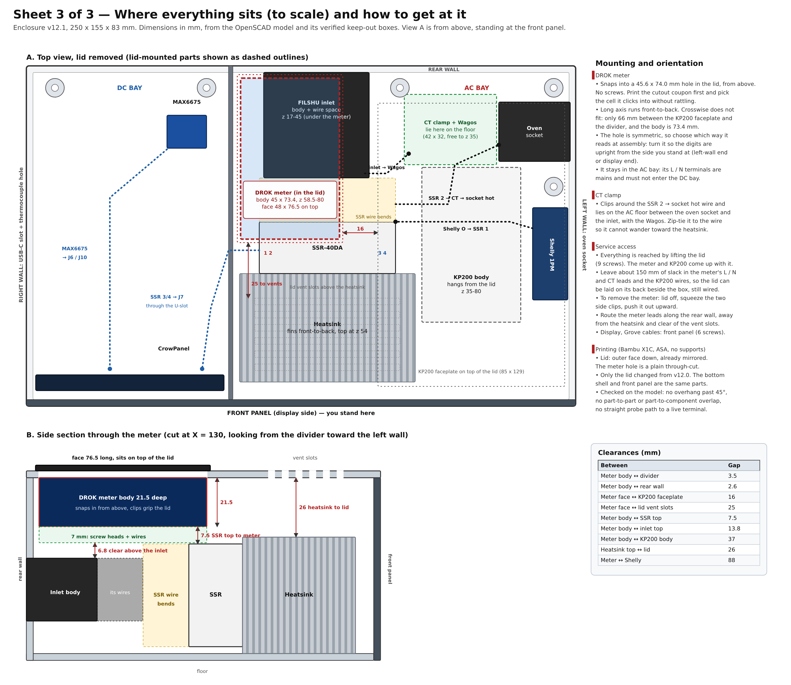

# 🌡️ DIY ESP32 Reflow Oven Controller (CrowPanel 2.8)

> **⚠️ SAFETY WARNING:** This project involves mains AC voltage, appliance modification, and high heat. Incorrect wiring can cause electric shock, fire, equipment damage, or severe injury. Do not attempt this unless you are experienced and comfortable working with mains AC wiring. Always verify wiring with a meter, confirm current ratings, use proper strain relief, bond ground correctly, and never leave the oven unattended while operating.

## 📖 Overview

This is a custom-built, cost-conscious reflow toaster oven controller for soldering Surface Mount Technology (SMT) printed circuit boards. It is a lower-cost alternative to reference designs like the [Adafruit EZ Make Oven](https://learn.adafruit.com/ez-make-oven/overview). It started on the "Cheap Yellow Display" (CYD, ESP32-2432S028R). **From v12 it uses the [Elecrow CrowPanel 2.8" ESP32 HMI](https://www.elecrow.com/esp32-display-2-8-inch-hmi-display-spi-tft-lcd-touch-screen.html)**, a CYD-class board that exposes enough I/O on keyed connectors to wire everything with **cables only, with no board modifications**. Elecrow sells the same board on Amazon as the "ESP32 Display 2.8 Inch (NerdMiner)" 2-pack ([B0H11B33ZK](https://www.amazon.com/dp/B0H11B33ZK)).

The controller is housed in a standalone, 3D-printed bench enclosure next to the toaster oven. The touchscreen sits in **landscape on the front panel** (the long side). A panel meter in the lid shows what the oven is drawing.

**Current version: v13.0** (compact enclosure, wiring sheets and firmware all in this repo).

| If you want to… | Go to |
| :--- | :--- |
| Build one, step by step | [docs/BUILD-GUIDE.md](docs/BUILD-GUIDE.md) |
| Hook up the wires | [Wiring sheets](#wiring-diagrams-v130) ([printable PDF](docs/wiring/reflow-wiring-all-sheets.pdf)) |
| Flash and run the controller | [firmware/reflow_controller/README.md](firmware/reflow_controller/README.md) |
| Print the enclosure | [Print advisory](#print-advisory) and [slicer settings](#slicer-configurations) |
| See why it is built this way | [docs/DESIGN-REVIEW-2026-10.md](docs/DESIGN-REVIEW-2026-10.md) |

### How It Works

* **Control:** The ESP32 follows a reflow profile with a PID loop and switches the oven's heating elements through a Solid State Relay (SSR) using slow-PWM (2-second window).
* **Sensing:** Reads the chamber temperature from a K-type thermocouple through a MAX6675 module, four times a second.
* **Safety:** A Shelly 1PM Gen4 smart relay sits in the oven's hot conductor as an independent master cutoff. The controller has to re-arm it every 15 s over Wi-Fi; if the controller hangs or resets, the Shelly opens by itself 30 s later. Before every run the controller also reads the Shelly's power meter to check that the SSR has not failed closed. A script on the Shelly adds its own trips.
* **Metering:** A DROK AC panel meter in the lid shows line voltage and the oven's current, power and energy, from a clamp-on current transformer on the oven's hot wire.
* **UI/UX:** Profile picker, START/STOP, live temperature graph against the profile, and plain-language abort reasons on the 320 × 240 landscape touchscreen.

---

## ✨ Features & Project Status

| Area | State | Notes |
| :--- | :--- | :--- |
| **Controller board** | 🟡 Ordered | CrowPanel 2.8 bought as the Amazon "NerdMiner 2.8" 2-pack (2026-11). Pinout taken from Elecrow's own Eagle schematic, board files and STEP model. Run the [bench checks](#pin-configuration-mapping-crowpanel-28-cables-only) before wiring mains |
| **AC distribution** | ✅ Validated | Inlet → Shelly → KP200 branch energized and confirmed on the earlier build. Shelly joins Wi-Fi and reports metering; the KP200 powers the display through a USB adapter |
| **Oven load path** | ⬜ Not yet wired | Shelly `O` → SSR → CT clamp → oven socket |
| **Reflow firmware** | 🟡 Written and PC-tested, not yet run on hardware | `firmware/reflow_controller/`: four profiles, PID with slow-PWM, safety aborts, touch UI, Shelly heartbeat, stuck-SSR check. The real sketch runs on a PC against a simulated oven and Shelly ([`firmware/host_test/`](firmware/host_test/README.md): 27 scenarios, both boards). The first real compile is in the Arduino IDE |
| **Shelly supervisor script** | 🟡 Written and PC-tested, not yet installed | `firmware/shelly/reflow_supervisor.js`: max on-time, over-temperature, power-while-idle, and a 5-minute lockout after any trip |
| **Metering** | 🟡 Designed in | DROK AC multimeter ([B0B3WVG2V9](https://www.amazon.com/dp/B0B3WVG2V9)) snaps into the lid; its split-core CT goes on the oven hot wire |
| **Enclosure** | 🟡 v13.0 modelled and checked, print pending | OpenSCAD parametric design, **184 × 140 × 83 mm, ASA** (v12 was 250 × 155: a third less bench area with the same parts), prints on a Bambu X1C without supports. Checked by surface scan, interference test and probe-ray test (see [Slicer Configurations](#slicer-configurations)) |
| **Wiring documentation** | ✅ Done | Three illustrated sheets with tagged wires and wire lists |

**Carried forward from the CYD era (validated on the CYD):** resistive touch UI, MAX6675 reading with a live graph, SSR switching at 3.3 V drive.

**Safety design:**
* **Isolation:** The display, its cables and the thermocouple amplifier sit in their own pocket behind the front panel, walled off from the mains bay. One slot for the SSR control pair is the only crossing.
* **Fail-safes:** Fused rocker inlet, a Shelly 1PM Gen4 in the oven's hot path (survives a shorted SSR), SSR drive that is **off whenever the ESP32 is not actively driving it**, a KP200 that can cut the controller's power, and the oven's own thermostat left in circuit at maximum.
* **Firmware aborts:** open thermocouple, 260 °C hard limit, 30 °C overshoot, heating hard with no temperature rise, 15-minute run limit, lost Shelly heartbeat, relay opened by the Shelly, SSR stuck on, stalled control loop, STOP button.
* **Two watchers:** the control loop and the Shelly link run as separate tasks. If the Shelly stops answering, the control loop aborts; if the control loop stops running, the Shelly task releases the SSR and opens the relay.

---

## 🛠️ Bill of Materials (BOM)

Everything in this table is on hand for the reference build as of 2026-11 (the display boards are on order). The full shopping list with terminals, sleeving and fasteners is in [docs/BUILD-GUIDE.md](docs/BUILD-GUIDE.md).

| Component | Part / Model | Notes |
| :--- | :--- | :--- |
| **Microcontroller / UI** | [Elecrow CrowPanel 2.8" ESP32 HMI](https://www.elecrow.com/esp32-display-2-8-inch-hmi-display-spi-tft-lcd-touch-screen.html) (ESP32-WROOM-32-N4, ILI9341V, resistive touch). On Amazon: Elecrow "ESP32 Display 2.8 Inch (NerdMiner)" 2-pack, [B0H11B33ZK](https://www.amazon.com/dp/B0H11B33ZK) | Replaces the CYD in v12. Mounts on the front panel; its acrylic case is **not** used. **Not** the CrowPanel *Advance*, which is a different board. If it arrives running mining firmware, flashing the reflow sketch replaces it |
| **Backup board (optional)** | Freenove ESP32-S3 Display 3.5" (FNK0104N) | Supported by the firmware (`BOARD_FREENOVE_S3_35`); different pins, SSR active-high, and it needs its own front panel. See the [firmware README](firmware/reflow_controller/README.md) |
| **Cables to the display** | 3 × Grove / HY2.0-4P to female DuPont, ≥ 20 cm | One each for J7, J6 and J10. One end of the SSR cable is cut and stripped. Elecrow's retail kit includes one cable; check what your pack includes |
| **USB cable + adapter** | USB-A to USB-C + 5 V USB adapter in the KP200 | The plug enters through the right-wall slot (15 × 9 mm); its overmold must be ≤ 13.5 × 7.5 mm |
| **Toaster Oven** | [Black & Decker TO1313SBD](https://a.co/d/00ZCCpC5) | 1150 W @ 120 V = **9.6 A continuous** |
| **Thermocouple Amp** | [MAX6675 Module + K-Type Thermocouple Probe](https://a.co/d/0htQOedm) | Runs from the CrowPanel's 3.3 V (MAX6675 supply range 3.0–5.5 V) |
| **Solid State Relay** | [Inkbird SSR-40DA + Aluminum Heatsink](https://a.co/d/078ydj3f) | Input 3–32 VDC per the listing. Wired with **bare wire under the clamp plates** (no lugs) |
| **Smart Master Relay** | [Shelly 1PM Gen4](https://a.co/d/01A2Ngha) (`S4SW-001P16EU`) | 16 A resistive, power metering, in the oven's hot path |
| **Panel Meter** | [DROK AC multimeter, 50–300 V, 0–100 A, with split-core ("open") current transformer](https://www.amazon.com/dp/B0B3WVG2V9) | Snaps into the lid. Measured: face 76.5 × 48 mm, body 73.4 × 45 mm, 21.5 mm deep. Voltage leads from the hot and neutral Wagos; CT around the oven hot wire |
| **Meter voltage leads** | 18 AWG hook-up wire, 600 V, black and white, ~0.5 m each | 14 AWG also works if the meter's terminals accept it |
| **AC Power Inlet** | [FILSHU 15A 250V IEC320 C14 Panel Mount Rocker](https://a.co/d/0dQGxSvV) | **15A** single-pole rocker with 14 AWG leads; switches hot only; snap-in. Panel cutout spec 47.0–48.0 × 27.0–27.5 mm; side clips are made for a 1.5 mm panel (the wall is thinned beside them). Confirm ratings against the label molded on the module |
| **Inlet Fuse** | 15 A, 5 × 20 mm, time-delay | A 15 A time-delay fuse is fitted in the reference build. Check that its body is **ceramic** (glass bodies have low breaking capacity) and swap it if not |
| **Power Cord (wall → inlet)** | NEMA 5-15P to IEC C13, **14 AWG SJT, rated 15 A** | **Required.** Typical PC cords are 18 AWG (10 A); 9.6 A would load one to 96 % |
| **Accessory Outlet** | [KP200 Smart Outlet Module](https://a.co/d/0it13pHO) | **Always-live**, feeds the display's 5 V through a USB adapter. Top socket blanked |
| **Oven Feed** | FILSHU 15A 125V NEMA 5-15R panel-mount socket, 14 AWG leads | Snaps into the right side wall (as you face the front), toward the rear. 27 × 27 mm face, ~35 mm deep, cutout spec 24.5–25.0 mm square. 9.6 A is 64 % of its 15 A rating |
| **Splices** | [Wago](https://a.co/d/0g3QaYkX) 221-series lever nuts: **3 × 221-415** (5-port) | Hot, neutral and ground junctions (UL 486C: 600 V, 20 A, 24–12 AWG). The hot junction carries 4 wires since the meter was added, so the 3-port 221-413 used before v12.1 is too small |
| **Internal AC wire** | 14 AWG stranded UL 1015 (600 V, 105 °C), black / white / green, ~1 m each | Plus a 14 AWG ring terminal for the heatsink ground bond |
| **Sleeving** | 600 V heat-shrink over the SSR control cable, small heat-shrink for unused DuPont ends | The control cable runs a short way through the mains bay |
| **Heat-set inserts** | 18 × M3 for 4.2 mm pockets + 2 for the KP200 (4.5 mm pockets) | 8 lid-screw (shell), 6 front-panel (shell posts, horizontal), 4 display standoffs (front panel) |
| **Screws** | 8 × M3 × 6 countersunk (lid), 6 × M3 × 8 countersunk (front panel), 4 × M3 × 5 pan head (display) | Each length stops short of the bottom of its insert pocket (lid 2 mm, panel 1 mm, display 0.6 mm) |
| **Cable ties** | About 6, 2.5 mm wide | One holds the MAX6675 on its saddle; the rest tie the Wagos, the CT and the wiring to the three floor anchors |
| **Enclosure Material** | **ASA**, about 1 kg | Glass transition ~100 °C vs PETG ~81 °C; the heatsink stands on the printed floor. **Do not use PLA** |

---

## 📁 Repository Structure

```text
CYD-ReFlow-Oven/
├── 3MF/
│   ├── reflow-v13_0-bottom.3mf                     # v13.0 print files (same parts as the STLs)
│   ├── reflow-v13_0-front-panel.3mf
│   ├── reflow-v13_0-lid.3mf
│   ├── reflow-v12_0-coupons.3mf                    # Socket + inlet + CrowPanel coupons, one plate — print FIRST (unchanged in v13)
│   ├── reflow-v12_1-drok-meter-coupon.3mf          # DROK meter cutout coupon — print FIRST (unchanged in v13)
│   ├── legacy-v12_1/                               # v12.1 lid for the 250 × 155 mm box
│   ├── legacy-v11_0/
│   └── legacy-v10_3/
├── OpenSCAD/
│   ├── reflow-enclosure-compact-v13_0-x1c.scad     # ✅ CURRENT master source of record
│   ├── legacy-v12_1/                               # v12.1 source (250 × 155 mm box, full-depth low-voltage bay)
│   └── legacy-v11_0/                               # v11 source (230 mm box, CYD on the lid)
├── STL/
│   ├── reflow-v13_0-bottom.stl                     # Bottom shell: floor, walls, display pocket, posts, lid bosses
│   ├── reflow-v13_0-front-panel.stl                # Front panel with display window, printed face down
│   ├── reflow-v13_0-lid.stl                        # Lid: KP200 mount, DROK cutout, vents, ribs; pre-mirrored for printing
│   ├── reflow-v12_1-drok-meter-coupon.stl          # 3 meter cutout sizes × 2 panel thicknesses
│   ├── reflow-v12_0-crowpanel-coupon.stl           # Display region of the front panel, 1:1
│   ├── reflow-v12_0-oven-socket-coupon.stl         # 3 cut sizes × 3 panel thicknesses
│   ├── reflow-v12_0-iec-coupon.stl                 # Inlet cutout + clip reliefs
│   ├── legacy-v12_1/                               # v12.0 bottom and front panel, v12.1 lid (250 × 155 mm box)
│   ├── legacy-v11_0/                               # v11 230 mm box (CYD on the lid)
│   └── legacy-v10_3/
├── firmware/
│   ├── bench_test/bench_test.ino                   # CrowPanel bench test: SSR drive + MAX6675 over USB serial
│   ├── reflow_controller/                          # ✅ Reflow firmware
│   │   ├── reflow_controller.ino                   #    State machine, PID, slow-PWM SSR, safety, UI, Shelly task
│   │   ├── config.h                                #    Board choice, pins, PID gains, limits
│   │   ├── secrets.example.h                       #    COPY to secrets.h and edit: Wi-Fi name, password, Shelly IP
│   │   ├── profiles.h                              #    Reflow profiles
│   │   ├── types.h                                 #    Structs and enums (in a header so the Arduino IDE compiles them first)
│   │   ├── board.h                                 #    Display and touch for each supported board
│   │   ├── User_Setup_CrowPanel28.h                #    TFT_eSPI setup for the CrowPanel 2.8
│   │   └── README.md                               #    Setup, run flow, aborts, bench order, tuning
│   ├── shelly/reflow_supervisor.js                 # Supervisor script that runs on the Shelly itself
│   └── host_test/                                  # ✅ Runs the real firmware on a PC against a simulated oven and Shelly
│       ├── run.sh                                  #    Build + run: Arduino-prototype check, 27 scenarios per board, Shelly script tests
│       ├── host_test.cpp                           #    The scenarios
│       ├── stubs/                                  #    Simulated clock, pins, MAX6675, oven, Shelly; Arduino stand-ins
│       ├── shelly_script_test.js                   #    Tests reflow_supervisor.js under Node.js
│       └── README.md                               #    What is and is not covered
├── docs/
│   ├── BUILD-GUIDE.md                              # ✅ Parts, print, bench checks, assembly, first power, service
│   ├── wiring/                                     # ✅ Illustrated sheets (SVG, PNG, one PDF)
│   │   ├── reflow-wiring-ac-mains.*                #    Sheet 1: mains wiring, wires A1–A15
│   │   ├── reflow-wiring-low-voltage.*             #    Sheet 2: display, sensor, SSR drive, USB, Wi-Fi link, D1–D7
│   │   ├── reflow-layout-clearances.*              #    Sheet 3: to-scale layout, clearances, service access
│   │   └── reflow-wiring-all-sheets.pdf            #    All three, for printing
│   ├── VERIFY-v13_0.txt                            # Output of tools/verify_enclosure.py for v13.0
│   └── DESIGN-REVIEW-2026-10.md                    # Design re-review (Oct 2026) + v11, v12 and v13 updates
├── tools/
│   ├── verify_enclosure.py                         # Mesh health, supports, slicer-warning rule, interference, probe rays, real-board fit
│   ├── step_parts.py                               # Splits Elecrow's STEP into per-solid STLs for the fit check
│   ├── make_wiring_diagrams.py                     # Generates the three wiring / layout sheets (SVG)
│   └── render_diagrams.js                          # SVG → PNG + PDF (Playwright)
├── .gitignore                                      # Keeps secrets.h (your Wi-Fi password) and build output out of git
├── LICENSE                                         # BSD-2-Clause license file
└── README.md                                       # This file
```

### Print advisory

> ⚠️ **Print the coupons first**, in ASA: `3MF/reflow-v12_0-coupons.3mf` and `3MF/reflow-v12_1-drok-meter-coupon.3mf`. They are unchanged in v13.0: every cutout and the display mount are the same, so coupons you already printed and fitted still count.
> 1. **Oven-socket coupon:** 3 cut sizes (rows: 24.5 / 24.75 / 25.0 mm; dimples on the left edge = row) × 3 panel thicknesses (columns: 2.0 / 2.5 / 3.0 mm; dimples on the top edge = column). Pick the cell where the socket snaps in firmly; set `os_cut` / `os_panel_t` if they differ from 24.75 / 2.5.
> 2. **Inlet coupon:** confirm the FILSHU inlet snaps in.
> 3. **CrowPanel coupon:** fit 4 inserts, screw the bare board on (M3 × 5, connectors toward the notched edge), and check from the front that the whole active area shows and the glass does not touch the plastic (designed gap 0.6 mm).
> 4. **DROK meter coupon:** 3 cutout sizes (columns: 45.2 × 73.6 / 45.6 × 74.0 / 46.0 × 74.4 mm; dimples on the bottom edge) × 2 panel thicknesses (rows: 1 dimple on the left edge = 2.0 mm, 2 dimples = 3.0 mm). Push the meter in from the smooth side and pick the cell it clicks into. If it isn't the middle cell of the 3.0 mm row, set `drok_cut_w` / `drok_cut_l` / `drok_panel_t` and re-export the lid.
>
> Then print `reflow-v13_0-bottom`, `reflow-v13_0-front-panel` and `reflow-v13_0-lid`. The parts are 184 mm wide, which leaves 36 mm on each side of the 256 mm plate, so a normal brim fits.

---

## ⚡ System Architecture & Wiring

### Power Flow Topology

The line splits at the hot Wago. The oven path is switched twice; the accessory path and the meter's voltage sense are never switched.

```text
[Mains Wall Power]
       ↓
[FILSHU 15 A Fused IEC C14 Inlet + Rocker]   ← single-pole, switches HOT only
       ↓
   FUSED HOT (5-port Wago) ─┬───────────────────────┬──────────────────────┐
                            ↓                       ↓                      ↓
              [Shelly 1PM Gen4]  L → O    [KP200 Smart Outlet]     [DROK meter "L"]
                            ↓             (always live, never       (voltage sense)
                 [SSR Hot-Side Switching]      chopped)
                            ↓                       ↓
                 [DROK CT clamp on this wire]  bottom socket
                            ↓                       ↓
          [NEMA 5-15R socket, right side wall] [USB adapter] → USB-C → CrowPanel
                            ↓                  (cable enters the left side wall)
          [Black & Decker Toaster Oven]
```

**Why the split:** SSRs typically fail *shorted*. Killing the controller's power cannot stop a welded triac — only a mechanical contact in the oven's own hot conductor can. The Shelly is therefore the primary cutoff. The KP200 remains a useful secondary (no controller power means no SSR drive), and keeping the controller on an always-live feed means the display and thermocouple readout stay alive during an emergency stop so you can watch the temperature fall.

> 🛑 **Design Rule:** An IEC C14 inlet is an *input* connector. Never use a male inlet as an energized power output. The oven feed is a **female** NEMA 5-15R panel socket in the right side wall (`os_center_y = 21`, `os_center_z = 22`), so live contacts are recessed and the oven's own plug provides strain relief.

**Orientation.** From v13.0, left and right in this repo are **as you stand at the front panel, facing the display**. (Earlier versions used the CAD model's X direction, which is the mirror image. The SCAD comments now avoid the words and say *socket wall* and *USB wall*.) Facing the front: the display is on your left and the heatsink's intake slots are on your right. The oven socket is in the right side wall, toward the rear. The USB-C cable and the thermocouple enter the left side wall, toward the front. The inlet is on the rear wall, left of centre. In the lid: the KP200 on the left, the DROK meter at the right rear (it reads from the front), the vent slots at the right front.

### Signal Flow

```text
K thermocouple → MAX6675 → ESP32 (profile + PID) → IO32 pulls low → SSR input → oven heats
 (in the oven)   (°C every   (CrowPanel 2.8)        (2 s slow-PWM)   (LED on)
                  250 ms)          │
                                   └─ Wi-Fi, every 15 s: "stay on for 30 s" → Shelly relay
                                                          (pings stop → relay opens by itself)
```

### AC Terminal Map

The Wago lever nuts are the junctions. The Shelly's manual says not to use its `L` terminals to power other devices and not to put several wires under one terminal, so each Shelly terminal gets exactly one wire. Wire tags (A1–A15) are on [sheet 1](docs/wiring/reflow-wiring-ac-mains.png).

| From | To |
| :--- | :--- |
| Inlet **switched, fused hot** | WAGO 221-415 (hot) |
| Hot Wago | Shelly `L`; KP200 **Line**; DROK meter **L** (18 AWG) |
| Inlet **neutral** | WAGO 221-415 (neutral) |
| Neutral Wago | Shelly `N`; KP200 **Neutral**; oven socket **neutral** (wide slot); DROK meter **N** (18 AWG) |
| Inlet **ground** | WAGO 221-415 (ground) |
| Ground Wago | KP200 **Ground**; SSR heatsink bond (ring terminal); oven socket **ground** (round) |
| Shelly `O` | SSR `T1` |
| SSR `T2` | Oven socket **hot** (narrow slot), **through the DROK CT clamp** |
| CT leads | DROK meter CT terminals |
| Shelly `SW` | *unconnected — set input to detached* |

Shelly screw terminals: 0.2–2.5 mm² (14 AWG = 2.08 mm²), strip 6–7 mm, 0.4 N·m max. WAGO 221: 24–12 AWG, strip 11 mm.

> **Changes to an already-wired box.** **v12.1:** the hot junction needs a 5-port 221-415 for the meter's lead. **v12:** earlier revisions fed the KP200 from a second Shelly `L` terminal; if your box is wired that way, move the KP200 line to the hot Wago.

> **Lead colours:** the FILSHU listing photo shows black, white and green leads. Identify hot, neutral and ground on *your* module with a meter (the fuse must be in the hot leg) before wiring; do not go by colour alone.

The Shelly has **no ground terminal** — it is double-insulated. The SSR has **no ground terminal** either; only its metal heatsink is bonded, via a ring terminal under a heatsink screw. Never land mains ground on `T3`/`T4` (those are DC control).

### DROK panel meter

* **Voltage leads:** two thin wires from the hot and neutral Wagos to the meter's 50–300 V input. They carry almost no current but sit behind the 15 A fuse, so use 600 V rated wire and keep them short.
* **CT clamp:** open it and close it around the SSR `T2` → socket-hot wire **only**. Around hot and neutral together it reads zero. It lies on the floor between the oven socket and the inlet with the Wagos (a 58 × 37 mm zone, free to 37 mm above the floor, with two cable-tie anchors); tie it down so it cannot wander toward the SSR's terminals.
* **What it shows:** line voltage whenever the rocker is on, and the oven's own draw: about 9.6 A / 1150 W while the SSR is on, pulsing during a run. If the watts read wrong or negative, turn the clamp around.
* **Terminals:** the drawings show the rear terminals generically. Use the labels printed on the back of your meter for which two screws are the voltage input and which two take the CT.
* **Service slack:** leave about 150 mm of slack on the meter's leads (and the KP200's), so the lid can be laid on its back beside the box while still wired.

### SSR wiring (straight wire, no lugs)

* **Orientation:** mount the SSR on the heatsink with its **AC terminals (`T1`, `T2`) at the end toward the oven-socket side wall** (your right, facing the front) and its **DC terminals (`T3`, `T4`) at the end toward the display pocket**. Turn the SSR 180° on the heatsink if yours is the other way round.
* **Clearance (modelled and checked as keepouts):** the wires leave the clamps straight out of the SSR ends. At the AC end there is a 13 mm channel, the full height of the SSR, between its end and the side wall; the wires turn toward the rear there, to the oven socket and the Wagos. At the DC end there are 12 mm to the display pocket's side wall, and the control slot is a short run along the heatsink from there.
* **Terminations:** strip to the depth of the clamp plate, twist the strands, and seat them fully under the plate. **Do not tin the ends with solder:** tinned ends compress and loosen under a screw clamp ([Wiring Harness News](https://wiringharnessnews.com/2901/)); ferrules are the alternative if you want one. The NEC sets no terminal bending space for 14–10 AWG ([Table 312.6(A)](https://open-exam-prep.com/study-guides/mn-electrician/ch13-boxes-cabinets/cabinets-cutout-bending-space)), but pre-form the upper AC wire's bend on the bench.
* **Order:** wire the SSR on the bench before dropping the heatsink into its fence. The terminal screws face the rear of the box and are awkward to reach in place.

### Shelly 1PM Gen4 Configuration

| Setting | Value | Reason |
| :--- | :--- | :--- |
| Power-on default | **Off** | A power blip must never energize the oven |
| Input mode | Detached / button | `SW` is unconnected |
| Overpower protection | **1400 W** | Hard backstop above the 1150 W nameplate |
| Overcurrent protection (`current_limit`) | **11 A** | Second backstop: above the 9.6 A load, below the 15 A fuse |
| Relay duty | On before a run, off after | Never PWM — 16 A contacts are rated ~10⁵ cycles |
| IP address | DHCP reservation | The firmware reaches it at `SHELLY_HOST` in `secrets.h` |

**Watchdog (built into the firmware).** During a run the controller calls this every 15 s:

```
http://<shelly-ip>/rpc/Switch.Set?id=0&on=true&toggle_after=30
```

Each call re-arms a 30-second auto-off. If the firmware hangs or the controller reboots, the calls stop and the Shelly opens on its own.

* **A missed call is retried every 2 s.** A short Wi-Fi dropout does not end the run; if no call gets through for 25 s, the controller aborts the run itself, before the Shelly's 30 s runs out.
* **The controller never re-closes a relay the Shelly opened.** Before each call it asks for the relay's state (`Switch.GetStatus`). If the Shelly has opened it (power or current limit, the script below, the 30 s timeout, or someone in the app), the controller leaves it open and aborts with "Shelly opened its relay".
* **Stuck-SSR check.** After START the controller closes the Shelly relay, holds the SSR off for 5 s and reads the Shelly's power. More than 40 W means the SSR is conducting on its own (SSRs fail shorted), and the run is refused with "SSR stuck on: replace it". The same check repeats at every heartbeat that finds the SSR off for 5 s or more.
* With `SHELLY_REQUIRED true` (the default) a run will not start unless the Shelly answers.

**Supervisor script ([`firmware/shelly/reflow_supervisor.js`](firmware/shelly/reflow_supervisor.js)).** Runs on the Shelly itself, independent of the controller. In the Shelly web UI: Scripts → Create script, paste it, Save, Start, and enable "Run on startup". It opens the relay when any of these is true:

| Trip | Threshold |
| :--- | :--- |
| Relay on too long in one go | 15 min |
| Shelly's own temperature | above 70 °C |
| **Power drawn while the controller says it is idle** (the relay closed outside a run, from the app for example, and the SSR conducting) | more than 40 W for 6 s |

The controller tells the Shelly whether a run is active by writing the key `reflow_active` to the Shelly's KVS store.

**After a trip the script holds the relay open for 5 minutes.** If anything closes it in that time, it is opened again at once, and a run started then aborts with "Shelly opened its relay". The reason is in the Shelly's script log. To clear the lockout sooner, stop and start the script.

### Wiring Diagrams (v13.0)

Three illustrated sheets in [`docs/wiring/`](docs/wiring/) (SVG, PNG, and one [PDF](docs/wiring/reflow-wiring-all-sheets.pdf) for printing). Every wire carries a tag that matches the wire list on its sheet. The devices are drawn as simplified likenesses and terminal positions are schematic: go by the labels printed on each part.

**Sheet 1 — AC mains** (wires A1–A15, colours and gauges)


**Sheet 2 — Low-voltage and signals** (wires D1–D7, connector pins, USB, Wi-Fi link)


**Sheet 3 — Layout, clearances and service access** (to scale, from the CAD model)


*Generated by `tools/make_wiring_diagrams.py` and `tools/render_diagrams.js`. Step-by-step build: [docs/BUILD-GUIDE.md](docs/BUILD-GUIDE.md).*

### Pin Configuration Mapping (CrowPanel 2.8, cables only)

**Source:** Elecrow's Eagle schematics in [Elecrow-RD/CrowPanel-2.8-ESP32-HMI-320x240](https://github.com/Elecrow-RD/CrowPanel-2.8-ESP32-HMI-320x240) (`Eagle_SCH&PCB`, revisions V1.0, V2.0 and V2.1). The three expansion connectors, their pin order and their pull-ups are identical in all three revisions. All three connectors carry **3.3 V**, not 5 V.

| Connector (silkscreen) | Pin 1 | Pin 2 | Pin 3 | Pin 4 | On-board pull-ups |
| :--- | :--- | :--- | :--- | :--- | :--- |
| **J7 `GPIO_D`** | IO25 | IO32 | 3V3 | GND | **1 kΩ to 3.3 V on IO25 (R18) and IO32 (R1)** |
| **J6 `IIC`** | IO21 (SCL) | IO22 (SDA) | 3V3 | GND | **1 kΩ to 3.3 V on both (R26, R27)** |
| **J10 `UART1`** | IO16 (RX2) | IO17 (TX2) | 3V3 | GND | none |

Pin 1 is the end marked with the triangle on the connector symbol. On-board peripherals use IO12/13/14/15/2 (display), IO33 (touch CS), IO36 (touch IRQ), IO27 (backlight), IO18/19/23/5 (microSD, its own bus), IO26 (speaker amplifier), and IO1/IO3 (USB serial).

| Function | ESP32 GPIO | Wire | Why this pin |
| :--- | :--- | :--- | :--- |
| **SSR drive (active-low)** | **IO32** | J7 pin 2 → SSR `T4` (−) | The 1 kΩ pull-up holds it high whenever the ESP32 isn't driving it (reset, boot, flashing, crash with the pin released), so the SSR sees 0 V |
| **SSR supply** | 3V3 | J7 pin 3 → SSR `T3` (+) | |
| **MAX6675 CS** | **IO21** | J6 pin 1 | Pull-up keeps the MAX6675 deselected during boot |
| **MAX6675 SCK** | **IO22** | J6 pin 2 | Bit-banged; firmware drives it, so the pull-up is harmless |
| **MAX6675 VCC / GND** | 3V3 / GND | J6 pin 3 / pin 4 | |
| **MAX6675 SO** | **IO16** | J10 pin 1 | No pull-up here. The MAX6675's output is specified at 1.6 mA sink; a 1 kΩ pull-up would ask it for 3.3 mA |
| *Unused* | IO25, IO17 | J7 pin 1 & 4, J10 pins 2–4 | Insulate the loose DuPont ends |

> 🛑 **Never connect the SSR's `T4` to GND (J7 pin 4).** With `T3` on 3.3 V that would turn the SSR on whenever the board is powered. The Shelly would still be the backstop, but the controller would have lost control of the heat.

**Drive margin.** The ESP32-WROOM-32 sinks 28 mA at 0.495 V (Espressif datasheet). The on-board pull-up adds 3.3 mA while the SSR is on. Inkbird does not publish the SSR's input current; generic SSR-DA datasheets give 3–25 mA across the full 3–32 V range, so at 3.3 V it should be well inside the limit. Measure it on the bench (below).

**Bench checks when the CrowPanel arrives** (USB power only, no mains):
1. Note the PCB revision on the silkscreen, and confirm the three connectors carry the names above (`GPIO_D`, `IIC`, `UART1`).
2. With nothing plugged into the expansion connectors, meter J7 pin 3 → pin 4: 3.3 V. J7 pin 2 → pin 4 should also read 3.3 V (pull-up) while firmware leaves IO32 alone.
3. Wire only the SSR (J7 pins 2 and 3) and flash `firmware/bench_test/bench_test.ino` (commands `1`, `0`, `t`, `s` over USB serial): the SSR's LED lights on `ssrOn()`. With it on, meter across `T3`–`T4` (expect ≥ 3.0 V, the SSR's minimum) and the input current in series (expect well under 24 mA).
4. Power-cycle and press RESET a few times while watching the SSR LED: it must stay off.
5. Fit the board on the CrowPanel coupon (window and glass gap), and check the USB-C cable's overmold fits the 15 × 9 mm slot.

**Pocket crossing.** One closed slot (`ctrl_slot`, 6 × 18 mm, 9 mm above the floor) in the display pocket's rear wall, at the end nearest the SSR's DC terminals, for the J7 SSR pair only. Thread the cable's bare ends through from the pocket side. Low-voltage wiring never runs in the mains bay otherwise. USB and the thermocouple enter the pocket from outside.

---

## 💻 Firmware & Flashing Rules

### Reflow controller (`firmware/reflow_controller/`)

> ⚠️ **Not yet run on hardware.** The sketch runs on a PC against a simulated oven, thermocouple chip and Shelly ([`firmware/host_test/`](firmware/host_test/README.md), 27 scenarios for each supported board). That tests the logic, not the hardware: the Arduino core, the display library and the real Shelly are stand-ins there. The first real compile is in the Arduino IDE, and the first runs belong on the bench with a lamp as the load.

Setup, in short (the [firmware README](firmware/reflow_controller/README.md) has every step):

1. Arduino IDE, Boards Manager: **esp32 by Espressif, 3.x**. Board: **ESP32 Dev Module**. Library: **TFT_eSPI**.
2. Copy `User_Setup_CrowPanel28.h` over `Arduino/libraries/TFT_eSPI/User_Setup.h` (back up the original).
3. Copy `secrets.example.h` to `secrets.h` in the same folder and set `WIFI_SSID`, `WIFI_PASSWORD` and `SHELLY_HOST` there, then upload. `secrets.h` is git-ignored, so the password stays out of this public repository.
4. First boot runs touch calibration. Hold a finger on the screen during boot to redo it later.

**A run:** pick a profile with `<` `>` and press **START**. The controller checks the thermocouple and that the oven is below 60 °C, has the Shelly close its relay, does the 5-second stuck-SSR check, then follows the profile. It chases the setpoint 15 s ahead because the oven lags, and whenever the oven is more than 10 °C behind, the profile clock **holds** so a weak oven stretches the profile instead of missing the peak. At the end it stops heating, opens the Shelly relay, and tells you to open the door slowly.

| Profile | Peak | For |
| :--- | :--- | :--- |
| Sn63/Pb37 leaded | 215 °C | Leaded paste |
| Sn42/Bi58 low-temp | 165 °C | Low-temperature paste |
| SAC305 lead-free | 245 °C | May not be reachable: the TO1313SBD's own thermostat tops out around 232 °C |
| Bake 120C 10 min | 120 °C | Drying boards and parts |

Profiles are compiled in from `profiles.h`; check them against your paste's datasheet.

**Any one of these ends a run** (SSR off, Shelly off, reason shown on screen):

| On screen | Cause |
| :--- | :--- |
| Thermocouple not reading | Probe open, unplugged, or a data wire fault (4 bad reads in a row) |
| Oven too hot to start | Above 60 °C at START |
| Over max temperature | Above 260 °C |
| Too far above profile | More than 30 °C above the profile |
| No temp rise: check probe | SSR above 80 % for 60 s with less than 5 °C rise: probe fell out, element failed, or the oven's own thermostat is limiting |
| Max run time exceeded | Run longer than 15 min |
| Shelly not reachable | No answer from the Shelly within 15 s of START |
| Lost contact with Shelly | No heartbeat got through for 25 s |
| Shelly opened its relay | The Shelly's own limits, its script, its timeout, or the app opened the relay |
| SSR stuck on: replace it | The Shelly measured more than 40 W with the SSR off |
| Controller stalled | The control loop stopped for 5 s; the Shelly task cut the heat |
| Stopped by user / from serial | STOP button, or `x` on serial |

**PC test.** `firmware/host_test/run.sh` builds the sketch with g++ and runs all of the above against a simulated oven and Shelly, for both boards, in a few seconds. Run it after any change to the firmware; [its README](firmware/host_test/README.md) says what it does and does not cover.

**Logging:** the serial port (115200) prints CSV lines `t_s,setpoint_c,temp_c,duty_pct,ssr,mode` for tuning the PID in a spreadsheet. Serial commands: `g` start, `x` abort.

**Backup board:** the Freenove ESP32-S3 Display 3.5" (FNK0104N) is supported with `BOARD_FREENOVE_S3_35` in `config.h`. It uses different pins, drives the SSR active-high, and needs a different front panel. Pin table and IDE settings are in the firmware README.

### Display and touch
Elecrow's bundled `TFT_eSPI/User_Setup.h` for this board: `ILI9341_DRIVER`, `TFT_MISO 12`, `TFT_MOSI 13`, `TFT_SCLK 14`, `TFT_CS 15`, `TFT_DC 2`, `TFT_RST -1`, `TFT_BL 27` (active high), `TOUCH_CS 33`, `SPI_FREQUENCY 15999999`, `SPI_TOUCH_FREQUENCY 600000`. These are what `User_Setup_CrowPanel28.h` contains. Touch is read with TFT_eSPI's `getTouch()`.

The board is mounted **connectors down**, upside down relative to how Elecrow's photos show it. Elecrow's examples use `setRotation(1)`; the firmware defaults to `TFT_ROTATION 3` for this mounting. If the image is upside down in the panel, change it in `config.h` and recalibrate touch. The microSD card is on its own SPI bus (IO18/19/23/5) and is not used.

### SSR drive (active-low, release = off)

```cpp
constexpr int SSR_PIN = 32;          // J7 pin 2; 1 kΩ pull-up on board; SSR + on J7 pin 3 (3V3)

void ssrOff() { pinMode(SSR_PIN, INPUT); }                            // released: pull-up -> SSR sees 0 V
void ssrOn()  { pinMode(SSR_PIN, OUTPUT); digitalWrite(SSR_PIN, LOW); } // sink -> SSR sees ~3.3 V

void setup() {
  ssrOff();                          // first thing in setup()
  // ...
}
```

Why this pattern: in the current Arduino-ESP32 core, `digitalWrite()` on a pin that `pinMode()` has not set up is ignored (it only logs an error), and `pinMode()` does not set the output level. So "write HIGH, then set OUTPUT" does not work as a glitch-free start. Releasing the pin to `INPUT` for off avoids the problem entirely: the board's pull-up does the work, and the pin is never driven high.

### Flashing
The USB-C port is reachable from outside the box (the side wall on your left, facing the front). GPIO1 is not used for the SSR, so flashing and `Serial` logging do not touch the heater. Keep the Shelly off while flashing anyway.

### Startup & Shutdown Order
* **Power up:** rocker on → controller boots (SSR released = off) → the firmware turns the Shelly on when a run starts.
* **Power down:** Shelly off (the firmware does this at the end of a run) → *then* rocker off.

---

## 🖨️ Enclosure & 3D Printing Production

The enclosure is three printed parts: an open-front **bottom shell** (floor, rear and side walls, the display pocket's walls, two front posts, the lid bosses), a **front panel**, and a **lid**. The lid carries the KP200 and the DROK meter.

### How the compact layout works (v13.0)

v12 gave the display a full-depth bay of its own, 89 mm wide, for a board stack that is 12 mm deep: about a litre of air. v13.0 keeps every part and every wire and removes that bay. Sheet 3 shows the result to scale.

* **Display pocket.** The display sits in a pocket behind the front panel: 89 mm wide, 31 mm deep at the floor (room for the MAX6675 and the cable bends) and 17 mm deep above 72 mm. Between those heights the pocket's rear wall leans forward at 45°, which keeps it in front of the KP200's front mounting screw and prints without support.
* **KP200 over the pocket.** The KP200's faceplate is 129 mm long but its body only 70.5 mm. The faceplate's front end now covers the pocket instead of empty lid. The body hangs in the mains bay 35 mm above the floor, and the inlet's wiring runs underneath it.
* **Mains bay.** An L shape around the pocket with about 208 cm² of floor (v12.1 had 228). Heatsink and SSR at the front right in the same fence, with a 10 mm intake plenum (was 8), the same 11 intake slots and 6 lid slots. The Wagos and the CT have a 58 × 37 mm zone at the rear between the oven socket and the inlet. The Shelly's pocket is on the left side wall behind the display pocket.
* **Front posts.** Two full-height posts stand in the intake plenum, one on each side of the intake slots. Each takes two front-panel screws and one lid screw.
* **DROK meter.** In the lid at the right rear, long side left-to-right, so the digits read from the front. Same 74.0 × 45.6 mm snap-in cutout. It sits 7.5 mm above the SSR and 26.8 mm from the vent slots.
* **Under the lid.** An L-shaped rib stops 0.5 mm above the heatsink, so the heatsink cannot lift out of its 5 mm fence; the same rib screens the meter's terminals and the KP200 from anything pushed through the vent slots. Two 8 mm ribs, behind and in front of the KP200, stiffen the lid against plug-in and pull-out forces. A bead along the front edge sits in a chamfer on the front panel's top edge and keeps the panel from bowing out.
* **Lid screws.** 8 (was 9), in bosses that hang from the walls on 45° undersides and in the two front posts. None stands on the floor and none is hidden under the KP200 faceplate.
* **MAX6675.** A cable-tie saddle on the pocket floor: two pads with side lips and a bar for the tie. It takes boards 25 to 32.5 mm long and up to 16 mm wide. The four-boss pattern in v12 was not from a measured part.
* **Wiring aids.** Three cable-tie anchors on the mains floor: two in the Wago zone, one in the channel between the heatsink and the KP200.

### Assembly order
Full version with parts, checks and first-power procedure: [docs/BUILD-GUIDE.md](docs/BUILD-GUIDE.md).

1. Inserts: 8 lid-screw inserts (shell, vertical), 6 front-panel inserts (shell posts, horizontal), 4 display inserts (front-panel standoffs), 2 KP200 inserts (lid). Pierce the four thin skins in the lid's KP200 holes.
2. Screw the CrowPanel to the front panel (4 × M3 × 5), connectors toward the floor. Plug the three Grove cables in now; the connectors face down.
3. Bench-wire the SSR (see SSR wiring), set the heatsink in its fence, fit the Shelly, inlet and socket. Cable-tie the MAX6675 to its saddle: tie under the bar first, then the board, then close the tie. Snap the DROK meter into the lid.
4. AC wiring per sheet 1, including the CT clamp on the SSR `T2` → socket-hot wire and the meter's leads. Tie the Wagos and the CT to the floor anchors.
5. Thread the J7 cable's bare ends through the slot in the pocket wall to `T3`/`T4`; J6/J10 go to the MAX6675 on the pocket floor.
6. Fit the front panel (6 × M3 × 8 countersunk).
7. Fit the lid. Its front bead drops over the panel's chamfered top edge, its L-shaped rib over the heatsink and its front rib into the top of the display pocket. Check that the meter's leads fold down behind the SSR and nothing is pinched. Plug the USB-C cable in through the side wall.

### Service access
* Everything in the mains bay is reached by taking the lid off (8 screws, all visible). The meter and KP200 lift with it; with the slack left on their wires the lid lies on its back beside the box.
* DROK meter out: lid off, squeeze the clips on its two long sides, push it up and out.
* Display, Grove cables and MAX6675: front panel (6 screws). With the lid on, swing the panel's bottom edge out and lower it out of the lid's bead. Refit top edge first.
* Fuse: in the inlet's drawer, from outside, cord unplugged.

### Enclosure Revision Milestones

* **v9.5:** CYD mounting hole pattern corrected 82×44 → **77.5×42 mm** (physically measured).
* **v9.6:** IEC cutout right-sized; `reflow-v9_6-iec-trim-plate.stl` retrofit spacer.
* **v9.9:** Display window passes the full standoff depth. The lid file is pre-mirrored for printing; do not mirror it again in the slicer.
* **v10 / v10.1 / v10.3:** KP200 flush-mount rework from teardown measurements (window 46 × 72 mm, yoke-ear recesses with 45° lead-ins, captive box-screw clearance).
* **v11.0:** AC bay rebuilt around the real parts: heatsink (measured 80 × 49.4 × 51 mm) along the front with the SSR on its rear face; NEMA 5-15R oven socket; FILSHU inlet cutout with clip reliefs; Shelly pocket; heatsink fence; intake and outlet slots.
* **v12.0:** CrowPanel 2.8 in landscape on a separate **front panel** printed face down (clean face, crisp chamfered window, standoffs straight up). Board geometry from Elecrow's outline drawing, the LCM datasheet and Elecrow's STEP model. Board mounted connectors-down so its USB-C faces the side wall and the cable plugs in from outside. Box 230 × 155 × 65 → **250 × 155 × 83 mm** (89 mm DC bay; height for the board plus a 15 mm cable zone below it). The taller box lifts the KP200 body to 35 mm above the floor, which opens a straight-wire path at the SSR's AC end. Lid: display window and bosses removed; outlet slots 7 → 6 and moved 3 mm forward (the taller box let a 45° probe through the old rear slot reach the SSR terminal edge). One divider pass-through instead of two.
* **v12.1:** DROK AC multimeter (face 76.5 × 48, body 73.4 × 45 × 21.5 mm, measured) snaps into a 45.6 × 74.0 mm cutout in the lid over the AC bay, above the inlet, long axis front-to-back. **Only the lid changed**; the bottom shell and front panel are the v12.0 parts. New `drok_meter_coupon` part, new keepouts for the meter body and its terminal zone, and asserts that keep it clear of the divider, the lid screw, the vent slots, the inlet and the SSR. The lid was re-exported in 2026-11 with one-layer skins over the four KP200 holes, after Bambu Studio warned about them (see Slicer Configurations).
* **v13.0 (Current):** Compact layout, **184 × 140 × 83 mm** (was 250 × 155 × 83), same parts and wire list. The full-depth low-voltage bay became a display pocket behind the front panel with the KP200 above it; the inlet moved 12 mm down; the DROK meter turned crosswise so it reads from the front; the lid bosses hang from the walls; new lid ribs, front-panel bead, MAX6675 saddle and cable-tie anchors. All three big parts are new; the five coupons are unchanged. Printed volume drops from about 450 to 320 cm³. Details: *How the compact layout works* above.

### Slicer Configurations
* **Orientation:** All STL assets are pre-oriented for printing. No supports are required. The front panel and the lid print **outer face down**; the lid is already mirrored, so don't mirror it in the slicer. In the lid, the four KP200 holes are closed by a one-layer (0.2 mm) skin inside the two ear recesses: push a small screwdriver through each before fitting the KP200.
* **v13.0 verification** (fresh OpenSCAD renders, `tools/verify_enclosure.py`; full output in [docs/VERIFY-v13_0.txt](docs/VERIFY-v13_0.txt)):
  * All nine parts, including the coupons, are watertight with consistent winding and fit the 256 × 256 mm bed.
  * The downward-surface scan finds only bridges (48 mm inlet top edge, 24.75 mm socket edge, the 18 mm bar of the MAX6675 saddle, 9 mm USB slot, 12 mm foot-recess ceilings at 0.8 mm, 5 mm cable-tie tunnels, and on the lid the two 22 × 15.5 mm roofs of the KP200 ear recesses, 1.2 mm above the bed), small round holes (insert pockets, thermocouple hole, control slot), and surfaces at 45° or steeper (the leaning part of the pocket wall, the undersides of the wall-hung bosses, lead-in chamfers, the front panel's window chamfer and countersinks).
  * **Slicer warning check.** The script also runs Bambu Studio's "floating cantilever" rule, re-implemented from Bambu Studio's source, on 0.2 mm slices of every part. The first v12.1 lid tripped the real warning in Bambu Studio: the KP200 screw holes passed through the ear-recess roofs, so the first roof layer had to draw the hole edges in mid-air. The lid closes those four holes with a one-layer skin, and the check flags no v13.0 part. The re-implementation reproduces the warning on the old lid, but no v13.0 part has been sliced in Bambu Studio itself yet.
  * There is zero volumetric interference between the shell, installed lid and installed front panel, and between them and 18 component keepouts (including the SSR wire zones, the Wago zone, the board, its cable and speaker plug zones, the USB-C plug, the MAX6675, and the meter body and terminal zone). No two keepouts overlap.
  * 43,393 straight probe rays through every lid slot, front intake slot, the USB-C slot and the thermocouple hole: none reaches a live part. From v13.0 the meter's terminals, the Wago zone and the KP200's side terminals count as live as well as the SSR, inlet, socket and Shelly terminals.
  * The check of Elecrow's STEP model against the printed parts (25 solids, standoff tops touching the PCB exactly) was run for v12.0 and not repeated for v13.0. The display mount (standoffs, window, panel thickness) is the same geometry. The pocket walls behind the board are new and are checked against the board's keep-out boxes, not against the STEP model.
  * Approximate inputs are labelled `APPROX` in the SCAD. The MAX6675 module and the meter's CT have not been measured: the saddle and the Wago zone are sized to take the common variants.
* **Material:** ASA. A normal brim fits (the parts are 184 mm wide).
* **Infill & Perimeters:** Minimum 3 perimeters, 30–40% gyroid infill.

---

## 🚧 Roadmap & Known Issues

### Completed Milestones ✅
* [x] Enclosure dimensions coupon-validated against physical AC components.
* [x] Successfully printed and verified structural bottom shell (v9.6).
* [x] Smart shutoff device selected: Shelly 1PM Gen4.
* [x] AC distribution wired and energized: inlet → Shelly → KP200 → USB adapter → display boots on mains.
* [x] Oven peak current resolved by spec: 1150 W / 9.6 A, inside the Shelly's 16 A rating.
* [x] Confirmed the fuse is in the hot leg.
* [x] C14 inlet upgraded to the 15 A FILSHU module (14 AWG leads).
* [x] ~~Replace the 13 mm oven-lead gland.~~ NEMA 5-15R panel socket since v11.
* [x] ~~SSR on GPIO 1 / R16 pad mod.~~ v12 drives the SSR from the CrowPanel's GPIO_D cable connector, active-low, no board mods.
* [x] ~~Decide the screen orientation.~~ Landscape on the front panel (v12).
* [x] ~~Redraw the wiring diagram.~~ Three illustrated sheets in `docs/wiring/` (redrawn for v13.0).
* [x] ~~Commit SSR / MAX6675 test sketches.~~ `firmware/bench_test/` for the CrowPanel pins.
* [x] Reflow firmware written: UI, profiles, PID, safety aborts, Shelly heartbeat and `KVS.Set` state publishing (`firmware/reflow_controller/`), plus the Shelly supervisor script (`firmware/shelly/`).
* [x] Firmware review (2026-11): heartbeat tolerates short Wi-Fi dropouts, never re-closes a relay the Shelly opened, stuck-SSR check, control-loop watchdog, script lockout after a trip, Wi-Fi password moved to a git-ignored `secrets.h`. PC test in `firmware/host_test/` (logic only, not hardware).
* [x] DROK panel meter designed into the lid, with a cutout coupon (v12.1).
* [x] Compact enclosure: 184 × 140 × 83 mm, display in a pocket behind the front panel (v13.0).
* [x] Parts on hand, including the 14 AWG / 15 A C13 cord and a 15 A time-delay inlet fuse. Display boards ordered (2026-11).

### Open Action Items 🛠️

**Print:**
* [ ] Print the coupons (ASA, unchanged since v12); set `os_cut` / `os_panel_t`; confirm the inlet snaps in; fit the CrowPanel on its coupon.
* [ ] Print the DROK meter coupon; note which cell fits; re-export the lid if it isn't the middle 3.0 mm cell.
* [ ] Slice the three v13.0 parts in Bambu Studio and confirm there is no support warning.
* [ ] Print the v13.0 bottom, front panel and lid in ASA.
* [ ] Measure the MAX6675 module and the meter's CT and check them against the saddle (25–32.5 × 16 mm) and the Wago zone (58 × 37 × 37 mm).

**Bench (USB power only, no mains):**
* [ ] CrowPanel bench checks 1–5 (Pin Configuration section).
* [ ] First real compile and flash of `firmware/reflow_controller/` in the Arduino IDE.
* [ ] SSR wired, no mains, `SHELLY_REQUIRED false`: START, watch the SSR LED pulse and the CSV output; pull the thermocouple plug and confirm it aborts. Set `SHELLY_REQUIRED true` again afterwards.

**Wire:**
* [ ] Check there is a third 5-port Wago (221-415) for the hot junction.
* [ ] Wire SSR `T2` through the CT clamp to the oven socket hot (narrow slot); neutral and ground via Wagos; meter leads.
* [ ] Confirm the inlet fuse body is ceramic, and record the rating molded on the FILSHU module.
* [ ] Finalize oven chassis entry point for the K-type thermocouple probe.

**First power and tuning:**
* [ ] Configure the Shelly (table above) and install the supervisor script.
* [ ] Lamp-load test from the build guide, section 5, then with the firmware and `SHELLY_REQUIRED true`. This is the first time the firmware talks to the real Shelly: confirm the serial log shows `# SSR off, Shelly reads 0.0 W` (or close to it) and no `Shelly status not understood` line.
* [ ] Dummy-load thermal run: log the Shelly's own temperature (`temperature.tC`) during 10 min at 100 % and 30 min at 50 % with the lid closed. The SSR can dissipate up to 15.4 W (9.6 A × 1.6 V max drop); the Shelly is rated to 40 °C ambient.
* [ ] First oven run empty, on the low-temp or bake profile; then tune the PID from the CSV log.

Background for several of these: the [Oct 2026 design review](docs/DESIGN-REVIEW-2026-10.md).

---

## 🛑 Final Safety Checklist Before Mains Power Authorization

Do not connect the device to wall power until every item below is explicitly checked:

- [ ] **Wiring Verification:** Trace out all connections using a digital multimeter on continuity mode, against sheets 1 and 2.
- [ ] **Mains Orientation:** Explicitly confirm that the SSR switches the **Hot / Line** conductor, *never* the Neutral conductor.
- [ ] **Oven Socket Polarity:** Hot on the narrow slot, neutral on the wide slot, ground on the round hole; check with a plug-in outlet tester with the Shelly on and the SSR forced on (no oven attached).
- [ ] **Fuse Leg:** Confirm the inlet's fuse is in series with the hot conductor, not the neutral.
- [ ] **Shelly Default State:** Confirm power-on default is set to **off** before energizing.
- [ ] **Shelly Script:** `reflow_supervisor.js` is installed, running, and set to run on startup.
- [ ] **Firmware Safety Setting:** `SHELLY_REQUIRED` is `true` in `config.h` (it is only set `false` for the no-mains bench test).
- [ ] **SSR Drive:** `T3` on J7 pin 3 (3V3), `T4` on J7 pin 2 (IO32); **nothing** on J7 pin 4 (GND). SSR LED stays off through power-up, RESET and flashing.
- [ ] **Ground Path Bonding:** Confirm solid earth ground continuity from the inlet ground pin to the KP200, the SSR heatsink, and the oven socket ground.
- [ ] **Isolation Separation:** Low-voltage lines leave the display pocket only through the control slot and are sleeved in 600 V heat-shrink from there to the SSR.
- [ ] **Panel Meter:** The CT clamp is around the oven hot wire only and tied to it; the meter's voltage leads are 600 V rated, fully under their screws, and routed clear of the heatsink and vent slots. Nothing is pinched under the lid.
- [ ] **Touch Protection:** No exposed live AC terminals or loose strands. `T1` and `T2` are live whenever the Shelly relay is closed; every strand must be under its clamp plate.
- [ ] **Thermal Clearance:** Front intake slots and lid outlet slots unblocked.
- [ ] **Logic Verification:** Test the complete firmware logic path with the AC lines disconnected.
- [ ] **Constant Supervision:** Never leave the modified oven system unmonitored during live operations.

---
